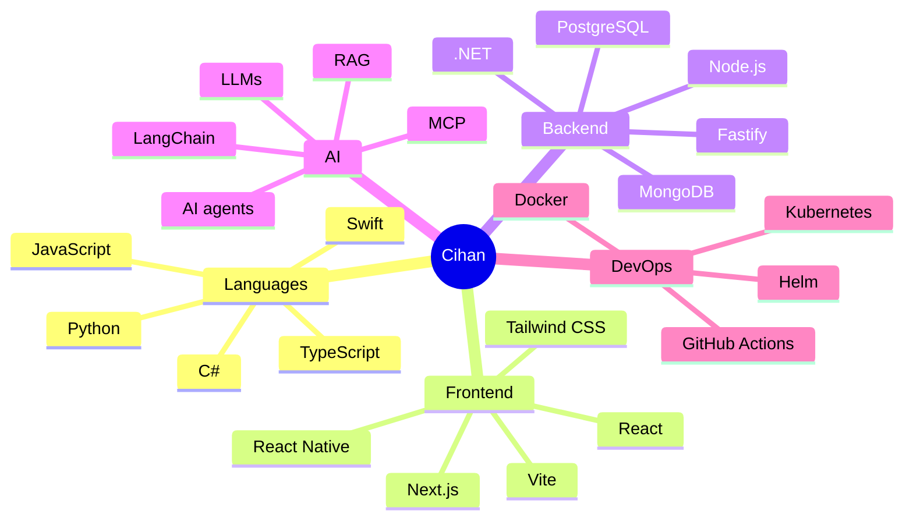
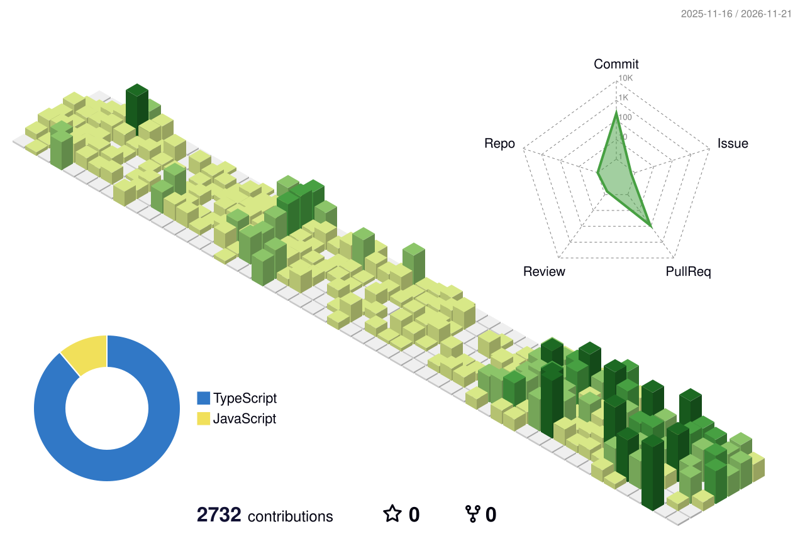

<p align="center">
  
</p>

<p align="center">
  
</p>

<p align="center">
  <a href="https://twitter.com/cihanalagoz"></a>
  
</p>

## 👋 whoami

```ts
const cihan = {
  home: "Ankara, Türkiye 🇹🇷",
  writes: ["TypeScript", "JavaScript", "Python", "C#", "Swift"],
  builds: ["web apps", "APIs", "AI agents", "developer SDKs"],
  ships: ["Docker", "Kubernetes", "Helm", "GitHub Actions"],
  onGitHubSince: 2015,
  status: "writing code",
  askMeAbout: ["React and Next.js", "AI agents and MCP", "making TypeScript types behave"],
} as const;
```

🌱 I also send fixes upstream, like [vercel/next.js#102014](https://github.com/vercel/next.js/pull/102014).

## 🧰 Tech I work with

<table>
  <tr>
    <td width="120"><b>Languages</b></td>
    <td></td>
  </tr>
  <tr>
    <td><b>Frontend</b></td>
    <td></td>
  </tr>
  <tr>
    <td><b>Backend</b></td>
    <td>
      <br/>
      
    </td>
  </tr>
  <tr>
    <td><b>AI</b></td>
    <td>
      
      
      
      
      
    </td>
  </tr>
  <tr>
    <td><b>DevOps</b></td>
    <td>
      <br/>
      
    </td>
  </tr>
</table>

<details>
<summary>🗺️ See it as a map</summary>



</details>

## 📊 GitHub in 3D

<picture>
  <source media="(prefers-color-scheme: dark)" srcset="https://raw.githubusercontent.com/cihanalagoz/cihanalagoz/main/profile-3d-contrib/profile-night-rainbow.svg">
  
</picture>

<p align="center">
  <picture>
    <source media="(prefers-color-scheme: dark)" srcset="https://streak-stats.demolab.com/?user=cihanalagoz&theme=github-dark-blue&hide_border=true&background=0D111700">
    
  </picture>
  <picture>
    <source media="(prefers-color-scheme: dark)" srcset="https://trophy.ryglcloud.net/?username=cihanalagoz&theme=onedark&no-frame=true&no-bg=true&row=2&column=2&margin-w=12&margin-h=12&title=Commit%2CPullRequest%2CFollowers%2CExperience">
    
  </picture>
</p>

## 🎮 Arcade corner

<p align="center">
  <a href="https://skyline-run.vercel.app/share/cihanalagoz"></a><br/>
  <sub>✈️ Every day is a building. Click and fly a plane through my year of commits.</sub>
</p>

<picture>
  <source media="(prefers-color-scheme: dark)" srcset="https://raw.githubusercontent.com/cihanalagoz/cihanalagoz/output/pacman-contribution-graph-dark.svg">
  
</picture>


